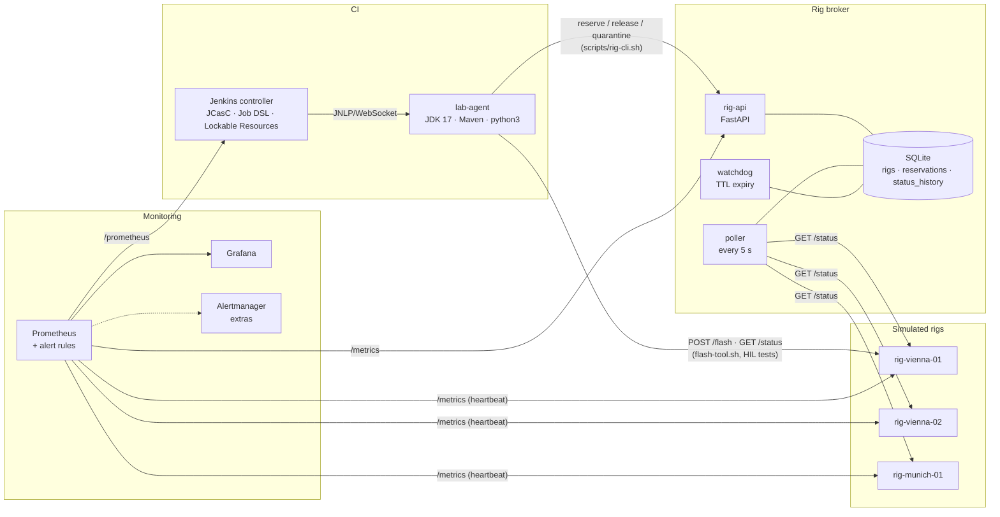
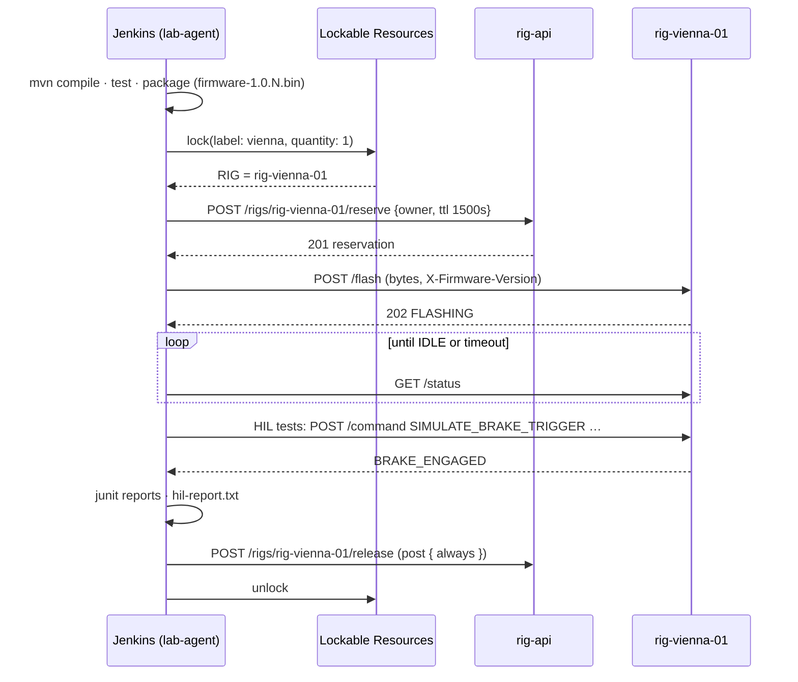
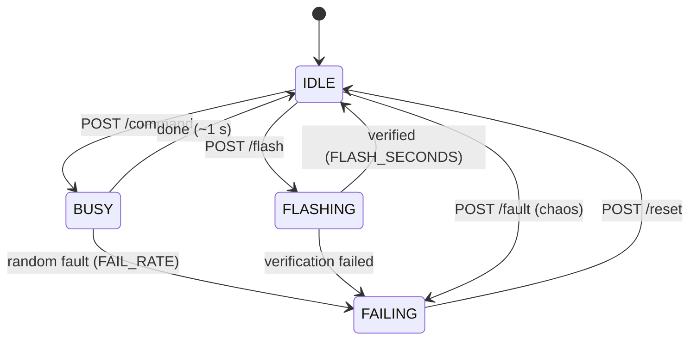

# Architecture

## Components and data flow

## Pipeline sequence

## Rig state machine (rig-sim)

The broker adds two derived states: `UNREACHABLE` (poll failed) and `UNKNOWN` (never polled).

## Why two locking mechanisms?

| | Lockable Resources (Jenkins) | Broker reservation (rig-api) |
|---|---|---|
| Scope | Jenkins builds only | anything: Jenkins, humans, other tools |
| Queueing | built in – builds wait on the lock | none – 409, caller retries/queues |
| Survives Jenkins crash | lock is released when the build dies | TTL + watchdog force-release |
| Knows rig health | no | yes – refuses FAILING/quarantined rigs |
| Audit trail | build log | `reservations` table, `/reservations` |

In production you would keep one as the source of truth (usually the broker) and have the other
mirror it – that's what `jenkins/pipelines/watchdog.Jenkinsfile` does for quarantine.

## Port map

| Port | Service |
|---|---|
| 8080 | Jenkins (50000: inbound agent TCP, unused when WebSocket) |
| 8000 | rig-api |
| 8101–8103 | rig simulators (container port 8080) |
| 9090 | Prometheus |
| 3000 | Grafana |
| 8081 / 9093 / 8082 | sqlite-web / Alertmanager / cAdvisor (extras) |

All containers share the `lab` Docker network; service names are DNS names (`rig-api`, `rig-vienna-01`, …).
